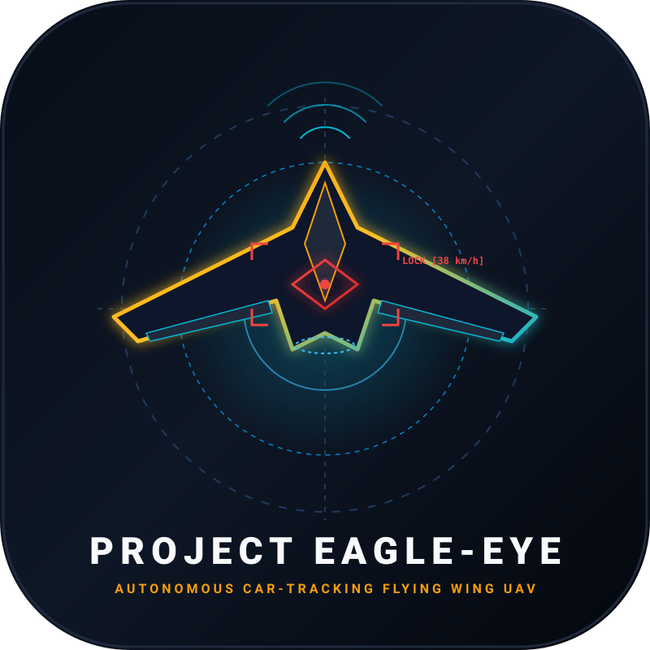

<div align="center">



# Project Eagle-Eye

### *Autonomous Car-Tracking Fixed-Wing Flying Wing Drone & High-Speed Visual Servoing System*

[](firmware/airborne_fc/)
[](ground_station/video_tracker.py)
[](firmware/ground_lora_bridge/)
[](LICENSE)
[](future.md)

<p align="center">
  <b>Ultra-Low-Cost (&lt; ₹2,000 INR New Spend) Autonomous Drone System: Real-time visual servoing, 25 Hz LoRa telemetry, 3-tier failsafe state machine, and instant manual FPV override.</b>
</p>

---

</div>

## 1. System Overview
**Project Eagle-Eye** is an autonomous hardware-software robotic system featuring a 920mm swept flying wing engineered to autonomously acquire, orbit, film, and pursue a moving car (30–60 km/h) along open highways, coastal routes, and mountain terrain while supporting deterministic sub-5ms manual FPV control takeover.

The entire system was researched, architected, and built under a strict new expenditure ceiling of **under ₹2,000 INR** in India by leveraging existing maker inventory (ESP32 DevKits, SX1278 LoRa transceivers, 18650 cells, and FPV gear).

---

## 2. Repository Architecture & Directory Structure
```
/dev/shm/eagle-eye/
├── bom/
│   ├── BOM.md                  # Comprehensive Indian sourcing guide (<INR 2,000)
│   ├── bom.json                # Structured JSON BOM with URLs, SKUs, and prices
│   └── WIRING.md               # Pinouts, power rails, LDO isolation, and schematics
├── firmware/
│   ├── common/
│   │   └── protocol.h          # 16-byte packed binary protocol & CRC16 definitions
│   ├── airborne_fc/            # 500Hz Mahony attitude estimator + Elevon mixer
│   │   ├── include/            # config.h, mahony.h, pid.h, mixer.h, gps.h, failsafe.h
│   │   ├── src/main.cpp        # Dual-core FreeRTOS flight control loop
│   │   └── platformio.ini      # ESP32-WROOM-32 PlatformIO build configuration
│   ├── ground_lora_bridge/     # 921600 baud USB-to-RF bidirectional serial bridge
│   │   ├── include/config.h
│   │   ├── src/main.cpp
│   │   └── platformio.ini
│   └── test_firmware_math.cpp  # C++ verification test suite
├── ground_station/
│   ├── video_tracker.py        # YOLOv8n car detector + ByteTrack + CSRT tracker
│   ├── kalman_tracker.py       # 2D Constant-Velocity 6-state Kalman filter
│   ├── pursuit_controller.py   # 3-State pursuit engine (Vision -> Coast -> GPS)
│   ├── manual_override.py      # Sub-5ms gamepad/keyboard FPV preemption
│   ├── lora_link.py            # Serial binary packet framing & loopback mock
│   ├── hud_dashboard.py        # Real-time OpenCV HUD overlay & MP4 flight recorder
│   ├── main.py                 # Integrated Ground Station application
│   └── tests/                  # Automated pytest test suite (100% pass)
├── cad/
│   ├── fuselage_pod.scad       # Parametric pod with IMU tray & 2° offset firewall
│   ├── fuselage_pod.stl        # Compiled 3D-printable mesh (1.2 MB)
│   ├── camera_mount_25deg.scad # 25° tilt + 15° orbit pan nose mount
│   ├── camera_mount_25deg.stl  # Compiled 3D-printable mesh (448 KB)
│   ├── battery_sled_3s18650.scad # Quick-swap cartridge with copper strip slots
│   └── battery_sled_3s18650.stl# Compiled 3D-printable mesh (135 KB)
└── docs/
    └── BUILD_AND_FLIGHT_GUIDE.md # Airframe cutouts, CG, tuning, and DGCA SOP
```

---

## 3. Verified Bill of Materials (< ₹2,000 INR)

| Component | Part Description | Vendor | Unit Price |
|---|---|---|---|
| **Motor** | A2212 1400KV Brushless Outrunner | QuartzComponents | ₹395.00 |
| **ESC** | SimonK 30A BLDC ESC with 5V 2A BEC | QuartzComponents | ₹305.00 |
| **Propeller** | Orange 8045 Pro-Range (Pair) | Robu.in / Quartz | ₹80.00 |
| **IMU** | GY-521 MPU-6050 6-DOF IMU | QuartzComponents | ₹127.00 |
| **GPS** | u-blox NEO-6M GPS with Ceramic Patch | QuartzComponents | ₹233.00 |
| **Servos** | 2x TowerPro SG90 9g Micro Servos | QuartzComponents | ₹172.00 |
| **LDO Regulator** | AMS1117-3.3V + 100µF Low-ESR Filter Cap | QuartzComponents | ₹25.00 |
| **Airframe Foam** | 5mm Sunpack / Coroplast Sheet (1000x600mm) | Local / Amazon | ₹120.00 |
| **Spars & Linkages** | 4mm Bamboo/Carbon Spars + Pushrods | Local / Kite | ₹60.00 |
| **Shipping** | Consolidated Courier Delivery | Standard Rate | ₹50.00 |
| **TOTAL NEW SPEND** | | | **₹1,567.00 INR** |
| **Budget Headroom** | **₹433.00 INR Remaining (21.65% under budget ceiling)** | | |

---

## 4. Hardware Pinout Allocation (ESP32-WROOM-32)
- **MPU6050 (I2C @ 400 kHz):** `SDA = GPIO 21`, `SCL = GPIO 22`
- **Ra-02 LoRa (VSPI @ 8 MHz):** `MOSI = GPIO 23`, `MISO = GPIO 19`, `SCK = GPIO 18`, `CS = GPIO 5`, `RST = GPIO 14`, `DIO0 = GPIO 26` (Powered via AMS1117-3.3V + 100µF capacitor)
- **u-blox NEO-6M GPS (UART2 @ 115200 baud, 5 Hz UBX):** `RX2 = GPIO 16`, `TX2 = GPIO 17`
- **PWM Outputs (50 Hz LEDC):** `Left Elevon = GPIO 13`, `Right Elevon = GPIO 12`, `30A ESC = GPIO 27`
- **Battery Voltage ADC:** `GPIO 34` (via 100kΩ / 20kΩ divider)

---

## 5. Software & Firmware Quickstart

### Running the Python Ground Station
```bash
# Run ground station in simulation mode (synthetic car video + mock LoRa link)
python3 ground_station/main.py --mock

# Run ground station with live USB FPV receiver and hardware LoRa bridge
python3 ground_station/main.py --source 0 --port /dev/ttyUSB0 --record flight.mp4
```

### Running Automated Test Suite
```bash
# Python Ground Station unit & integration tests
pytest ground_station/tests/ -v

# C++ Firmware core algorithms, structs, and failsafe verification
./firmware/test_firmware_math
```

### 3D Printing the Airframe Parts
The `.stl` files in `cad/` are ready to slice:
- Material: PLA+ or PETG
- Layer Height: 0.20 mm
- Infill: 20% Gyroid
- Wall Perimeters: 3
- Weight: Pod (~72g), Camera Mount (~24g), Battery Sled (~18g)

---

## 🔮 Engineering Roadmap

For on-board NPU edge inference, ExpressLRS integration, and RTK-GPS rooftop landing targets, explore the [Future Roadmap](future.md).

---

## 📄 License

Distributed under the **MIT License**. See `LICENSE` for details.
